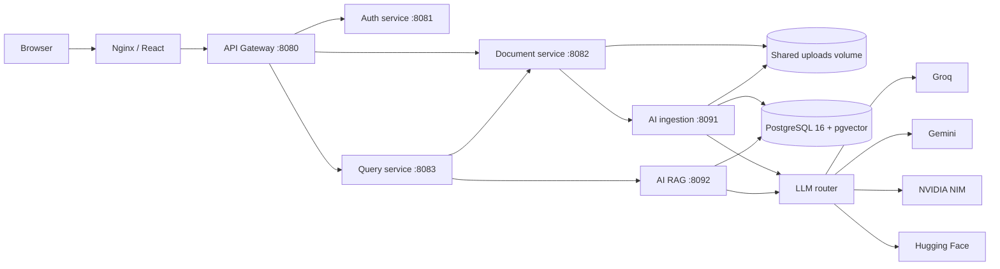
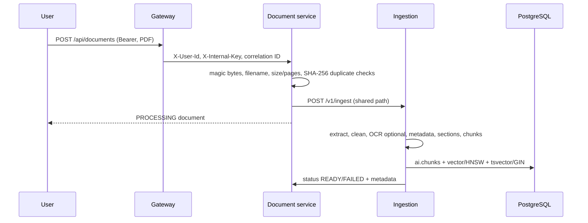
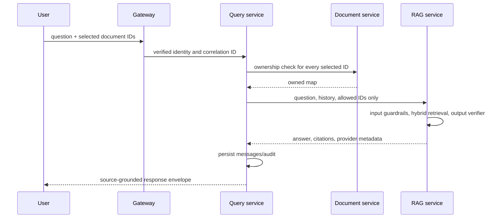
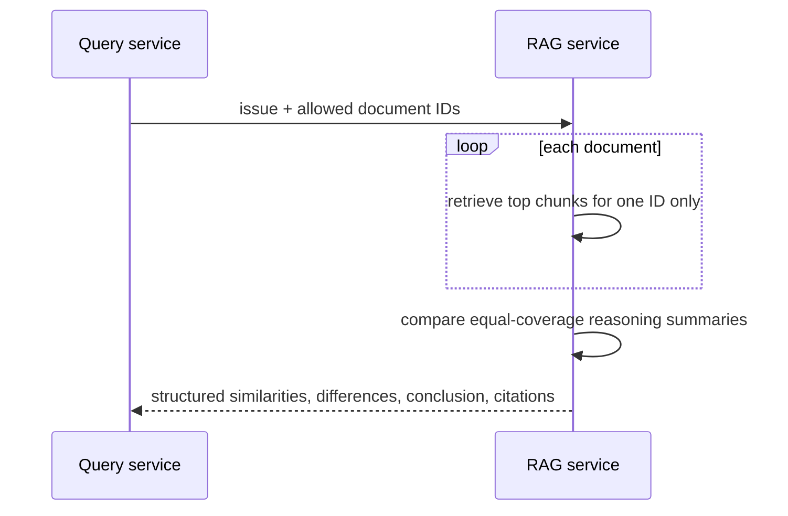
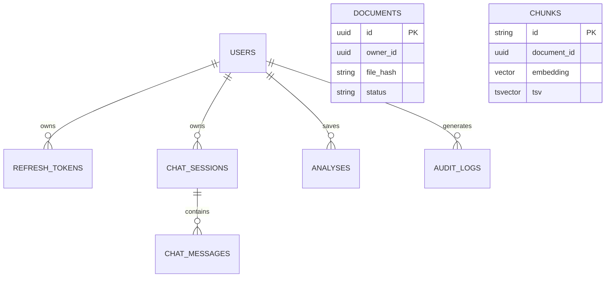
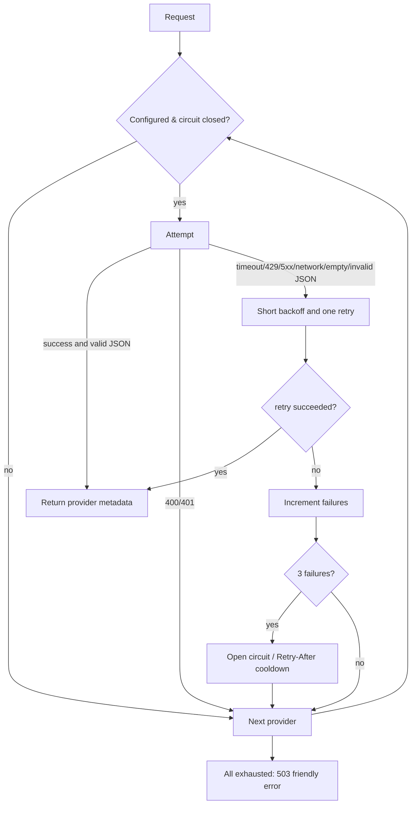
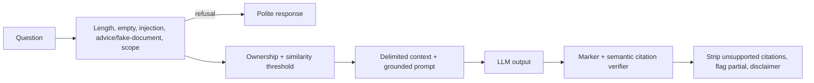

# Architecture

## System diagram

Only Nginx is host-published. The gateway is reachable from Nginx on the edge network and every service communicates over the internal Docker network. PostgreSQL contains separate `auth`, `documents`, `query`, and `ai` schemas.

## Responsibilities

| Component | Responsibility |
|---|---|
| Gateway | JWT validation, trusted identity headers, CORS, correlation ID and user/AI route limits. |
| Auth | Registration, BCrypt credentials, JWT issuance, refresh token hashing/rotation, account admin. |
| Documents | PDF validation, hashing, file storage, ownership, status and metadata callbacks. |
| Query | Owns sessions/messages/analyses/audit records; validates document ownership before RAG calls. |
| Ingestion | Extracts, cleans, OCR-falls-back, labels, chunks and locally embeds PDF text. |
| RAG | Applies guardrails, hybrid retrieval, answer/analysis chains and citation verification. |

## Request flows

### Upload and ingestion

### Query

### Compare

## ER diagram

The diagram intentionally shows logical ownership rather than foreign keys across schemas: services do not use cross-schema SQL.

## LLM fallback

## Guardrail pipeline

## Security design

- Gateway validates a 15-minute HMAC JWT and strips/replaces trusted user headers.
- Service mesh calls require the same `X-Internal-Key`; only health checks bypass it.
- Refresh tokens are random, BCrypt-hashed, expired after seven days and revoked/rotated per use.
- PostgreSQL schema ownership aligns with service ownership; no service queries a different schema.
- Files use generated UUID paths, not user-provided paths. A filename is sanitized and PDFs are checked before storage.
- User document and chat isolation is enforced by document-service and query-service before RAG receives IDs.
- Logs use correlation IDs and deliberately exclude credentials, tokens, keys and full document text.

## Design decisions

- **Microservices:** permits independent Java business domains and Python AI scale/runtime choices while retaining explicit ownership boundaries.
- **One local embedding model:** pgvector dimensions and similarity scores remain consistent; mixed embedding indexes silently corrupt retrieval quality.
- **Hybrid search:** dense vectors handle paraphrases while PostgreSQL FTS preserves exact legal terms, party names and statutory wording. RRF avoids fragile score-scale mixing.
- **Section-bounded chunks:** context remains legally interpretable and citations do not mix a holding with unrelated facts.
- **Provider-neutral HTTP adapters:** API fallback is transparent and does not couple core chains to a vendor SDK.
